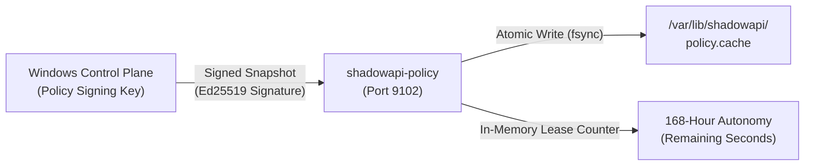

# KBA-SAH-002: Troubleshooting & Renewing 168-Hour Policy Autonomy Leases

**Article ID:** KBA-SAH-002  
**Category:** Operations & Policy  
**Severity:** Tier 2 (Critical)  
**Target Roles:** SecOps, Linux System Administrators, AppSec Leads  
**Applies To:** Shadow API Hunter Enterprise v1.0.0+ (`shadowapi-policy` daemon)  

---

## 1. Problem Description & Operational Symptoms

Distributed Linux sensor nodes are designed under **ADR-0004** to operate autonomously for up to **168 hours (7 days)** during control plane or network isolation. If the Windows Management API remains unreachable or unsynchronized beyond this window:

1. **Prometheus Alert**: `ShadowApiPolicyAutonomyExpired` fires.
2. **Readiness Probe**: `GET http://localhost:9102/health/ready` returns `HTTP 503 Service Unavailable`.
3. **Health Aggregator Metric**: `autonomy_active` drops from `1` to `0`, and `lease_remaining_seconds` drops to `0`.
4. **Behavioral Invariant**: Telemetry collection, privacy scrubbing, and durable spool buffering continue locally without disruption. However, new active verification probes and dynamic risk threshold evaluations freeze in their last-known safe configuration until a signed snapshot is delivered.

---

## 2. Technical Architecture & Cryptographic Mechanics

Every policy snapshot contains:
- `snapshot_id`: UUIDv4 identifier.
- `sequence_number`: Monotonically increasing 64-bit integer (`new_seq > current_seq`).
- `issued_at_utc` & `expires_at_utc`: Time-bounded lease (168h from issuance).
- `target_node_id`: Target node identifier or `*` (fleet-wide).
- `signature`: Ed25519 digital signature generated by the Windows Control Plane's trusted private key (`policy_signing.key`).



---

## 3. Step-by-Step Resolution & Lease Renewal Procedure

### Scenario 1: Automated Sync Failure (Network Partition Resolved)

If network connectivity between the Windows Control Plane and Linux nodes was interrupted and has now been restored:

1. Trigger an on-demand sync from the Windows Management host via PowerShell:
```powershell
Invoke-RestMethod -Uri "https://localhost/api/v1/policy/sync-fleet" `
    -Method POST `
    -Headers @{ "Authorization" = "Bearer $AdminToken" }
```

2. Inspect the Linux policy daemon log:
```bash
journalctl -u shadowapi-policy -n 50 --no-pager | grep -E "Signed policy snapshot received|Sequence"
```
Expected output:
```text
[shadowapi-policy] Ingested valid signed policy sequence=104, lease_remaining=604800s, autonomy_active=true
```

---

### Scenario 2: Manual Out-of-Band Policy Renewal (Air-Gapped Node)

If the node is completely isolated or undergoing extended air-gapped maintenance:

1. On the Windows Control Plane host, export and sign a fresh snapshot:
```powershell
# Export current policy snapshot from SQL Server
$snapshotJson = Invoke-RestMethod -Uri "https://localhost/api/v1/policy/export" -Method GET

# Save snapshot to file
$snapshotJson | Out-File -FilePath "C:\temp\snapshot-renew.json" -Encoding ascii

# Sign snapshot using the policy CLI tool
& "C:\Program Files\ShadowAPI\bin\ShadowAPI.Management.Jobs.exe" --sign-policy `
    --input "C:\temp\snapshot-renew.json" `
    --key-file "C:\ProgramData\ShadowAPI\keys\policy_signing.key" `
    --output "C:\temp\signed-snapshot.json"
```

2. Securely transfer `signed-snapshot.json` to the Linux sensor node (e.g. `/tmp/signed-snapshot.json`).

3. Deliver the signed snapshot to the local policy daemon:
```bash
curl -X POST http://127.0.0.1:9102/api/v1/policy/update \
    -H "Content-Type: application/json" \
    -d @/tmp/signed-snapshot.json
```

4. Verify HTTP response:
```json
{
  "status": "accepted",
  "sequence": 105,
  "autonomy_remaining_hours": 168.0,
  "autonomy_active": true
}
```

---

## 4. Verification & Validation Commands

Execute the following verification commands on the Linux node:

```bash
# 1. Verify Readiness Probe
curl -i http://127.0.0.1:9102/health/ready
# Expected: HTTP/1.1 200 OK

# 2. Check Policy Daemon Status
curl -s http://127.0.0.1:9102/api/v1/policy/status | jq .
```
Expected JSON:
```json
{
  "sequence": 105,
  "issued_at_utc": "2026-10-22T10:00:00Z",
  "expires_at_utc": "2026-10-29T10:00:00Z",
  "autonomy_active": true,
  "autonomy_remaining_seconds": 604780,
  "cached_disk_synced": true
}
```

---

## 5. Security & Anti-Tamper Guardrails

- **Anti-Rollback Enforcement**: If `new_seq <= current_seq`, the daemon rejects the snapshot with `HTTP 422 Unprocessable Entity` to prevent replay attacks.
- **Clock-Skew Tolerance**: Snapshots with timestamps drifting greater than `+/- 300 seconds` are rejected. Ensure NTP/Chrony is active: `chronyc tracking`.
- **Key Rotation**: If `policy_signing.key` is rotated, update the trusted public key hex on all Linux nodes in `/etc/shadowapi/policy.conf` before deploying new snapshots.
