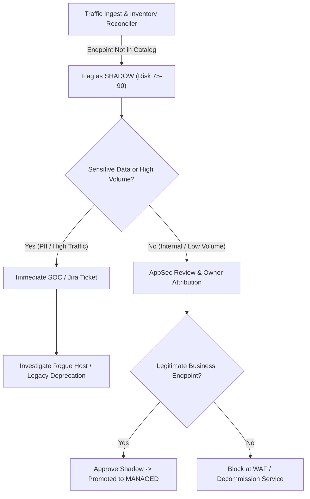

# KBA-SAH-004: Shadow API Triage, Ownership Assignment & Remediation

**Article ID:** KBA-SAH-004  
**Category:** Threat Triage & Incident Response  
**Severity:** Tier 1 (Medium to High)  
**Target Roles:** AppSec Analysts, SOC Responders, API Product Owners  
**Applies To:** Shadow API Hunter Enterprise v1.0.0+ (IIS Management UI & Windows Management API)  

---

## 1. Definition & Operational Context

A **Shadow API** is an operational HTTP/REST, gRPC, or GraphQL route discovered actively receiving traffic in enterprise environments that is **absent from approved OpenAPI specifications and registered CMDB software catalogs**. 

Unmanaged endpoints pose critical risks:
- Lack of rate limiting, WAF filtering, or authentication enforcement.
- Undocumented exposure of sensitive data classes (`CREDIT_CARD`, `PII`, `SSN`).
- Non-compliance with PCI-DSS v4.0 Requirement 6.3.2 (complete inventory).

---

## 2. Standard Triage Workflow (SOP)



---

## 3. Step-by-Step Operator Procedure

### Step 1: Locate Newly Discovered Shadow Assets in the UI

1. Open the Shadow API Hunter IIS Management UI: `https://shadowapi.corp.internal/`.
2. Navigate to **Tab 2: OpenAPI & Taxonomy Review**.
3. Under the **Asset Governance Table**, click the **`SHADOW`** filter pill.
4. Sort by **Risk Score (Descending)** to prioritize endpoints handling sensitive data or broken authentication.

---

### Step 2: Review Risk Evidence & Parameter Telemetry

Click on the target asset (e.g. `/api/v2/internal/export-records`) to inspect the sanitized telemetry drawer:
- **Observed Methods**: `POST`, `GET`
- **Data Classification**: `RESTRICTED` (contains `EMAIL`, `PHONE`)
- **Calling Clients**: Pseudonymized client count (e.g. 14 distinct clients)
- **First Seen / Last Seen**: Traffic duration and frequency
- **Evidence Record ID**: Tamper-evident proof link (e.g. `ev-f93a10...`)

> [!NOTE]
> All parameters displayed in the UI have been stripped of literal values and sanitized through the pre-ingest privacy engine. No passwords, tokens, or card numbers are ever stored or rendered.

---

### Step 3: Attribution & Owner Assignment

If the endpoint lacks an assigned owner:

**Via UI:**
1. Click **Assign Owner** on the asset row.
2. Enter the verified corporate email or Active Directory group (e.g. `payments-core@corp.internal`).
3. Enter justification: `Identified via payment gateway routing table reconciliation`.
4. Click **Confirm Assignment**.

**Via Management API (Automated / CI/CD):**
```powershell
$headers = @{
    "Authorization" = "Bearer $AdminToken"
    "Content-Type"  = "application/json"
}

$body = @{
    "asset_id"       = "c7a8291f-0b31-50e2-8b33-e9944a956d30"
    "owner_email"    = "payments-core@corp.internal"
    "service_id"     = "payments-service"
    "justification"  = "Verified team ownership"
} | ConvertTo-Json

Invoke-RestMethod -Uri "https://shadowapi.corp.internal/api/v1/inventory/assign-owner" `
    -Method POST -Headers $headers -Body $body
```

---

### Step 4: Governance Approval (Promoting to Managed)

If the endpoint is verified as legitimate production traffic and has been documented in an updated OpenAPI specification:

1. Click **Approve Shadow**.
2. Select target status: `MANAGED`.
3. Enter the linked specification reference: `banking-v2.json`.
4. Click **Approve**. The asset immediately transitions to `MANAGED` status across the inventory and SQL Server store.

---

### Step 5: Automated Ticketing Dispatch (Remediation)

If the endpoint represents unauthorized or high-risk exposure:

Dispatch an immediate incident ticket to Jira or ServiceNow:
```powershell
$ticketPayload = @{
    "provider"     = "jira" # or "servicenow"
    "finding_id"   = "finding-shadow-c7a8291f"
    "project_key"  = "SEC"
    "issue_type"   = "Security Incident"
    "summary"      = "Unapproved Shadow API Detected: /api/v2/internal/export-records"
    "description"  = "Discovered live traffic on unauthorized endpoint exposing customer PII."
    "priority"     = "High"
    "asset_id"     = "c7a8291f-0b31-50e2-8b33-e9944a956d30"
} | ConvertTo-Json

Invoke-RestMethod -Uri "https://shadowapi.corp.internal/api/v1/remediation/ticket" `
    -Method POST -Headers $headers -Body $ticketPayload
```

---

## 4. Verification & Audit Trail Validation

1. Query asset governance state:
```powershell
Invoke-RestMethod -Uri "https://shadowapi.corp.internal/api/v1/inventory/taxonomy" -Method GET
```
2. Confirm the asset status is updated and reflected in SQL Server audit table `inventory.AssetAuditLog`.
3. Check bi-directional webhook status if Jira/ServiceNow was dispatched:
```powershell
Invoke-RestMethod -Uri "https://shadowapi.corp.internal/api/v1/remediation/tickets" -Method GET
```
