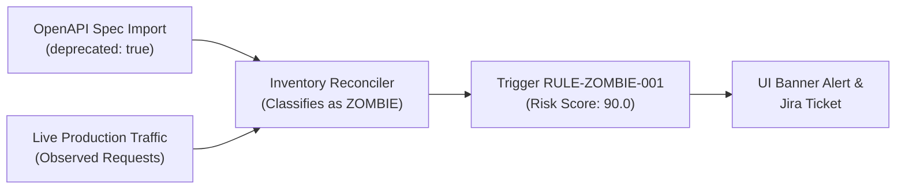

# KBA-SAH-005: Deprecated Zombie API Detection & Decommissioning

**Article ID:** KBA-SAH-005  
**Category:** Governance & API Hygiene  
**Severity:** Tier 1 (Medium to High)  
**Target Roles:** API Product Owners, AppSec Leads, Solution Architects  
**Applies To:** Shadow API Hunter Enterprise v1.0.0+ (OpenAPI Parser & Inventory Reconciler)  

---

## 1. Definition & Risk Context

A **Zombie API** is an application endpoint that has been explicitly marked as **deprecated, retired, or superseded** (e.g. in OpenAPI specs via `deprecated: true` or in CMDB as `operational_status = Retired`), yet **continues to receive live production traffic**.

### Threat Vector
Attackers actively target Zombie APIs because:
- Older API versions often lack modern authentication controls (e.g. mTLS, OAuth2 PKCE).
- Security patches applied to v2/v3 endpoints are rarely backported to v1 legacy endpoints.
- Organizations falsely assume deprecated endpoints are dead, leaving them unmonitored.

---

## 2. Detection & Identification Workflow

### Step 1: Filter Zombie Endpoints in the Management UI

1. Open the IIS Management UI: `https://shadowapi.corp.internal/`.
2. Navigate to **Tab 5: Spec Diff & Drift**.
3. Inspect the **Live Production Traffic Drift Table**:
   - Filter by **Drift Type**: `ZOMBIE_USAGE`.
   - Identify endpoints with `Severity: CRITICAL` and `Risk Score: 90.0`.
   - Example: `GET /api/v1/auth/authenticate` marked deprecated in `banking-v2.json` specification.



---

## 3. Decommissioning Standard Operating Procedure (SOP)

### Phase 1: Identify Legacy Caller Systems

Before revoking the route, identify the upstream client applications calling the Zombie API:

1. Query calling client pseudonyms via the Management API:
```powershell
$assetId = "a1b2c3d4-e5f6-7890-abcd-ef1234567890"
Invoke-RestMethod -Uri "https://shadowapi.corp.internal/api/v1/inventory/assets/$assetId/callers" `
    -Method GET -Headers @{ "Authorization" = "Bearer $AdminToken" }
```
2. Trace client IP addresses and user agents (e.g. `MobileApp/v1.2 (iOS 14.1)` or `LegacyBatchCron/2021`).

---

### Phase 2: Implement RFC 8594 Sunset & Deprecation Headers

Direct the API Gateway (Envoy/Kong/APIM) to inject RFC 8594 deprecation warning headers on all responses for the Zombie route:

```http
HTTP/1.1 200 OK
Deprecation: @1792500000
Sunset: Wed, 11 Nov 2026 00:00:00 GMT
Link: <https://api.corp.internal/docs/v2/migration>; rel="sunset"; type="text/html"
```

---

### Phase 3: Traffic Shadowing & Migration Verification

1. Notify the consumer application teams of the hard sunset deadline.
2. Monitor traffic dropoff in Shadow API Hunter **Tab 1: Inventory Overview**.
3. Verify that requests to the v1 route approach zero while traffic to the modern v2 endpoint increases proportionally.

---

### Phase 4: Final Route Decommissioning & Block Rule

Once traffic reaches zero (or only unauthorized scanners remain):

1. Remove the route binding from the API Gateway or WAF configuration.
2. Return `HTTP 410 Gone` on all subsequent attempts.
3. In Shadow API Hunter, update the asset lifecycle state:
```powershell
$payload = @{
    "asset_id"       = $assetId
    "lifecycle_state" = "DECOMMISSIONED"
    "justification"  = "Route sunset completed per AppSec Ticket SEC-4091"
} | ConvertTo-Json

Invoke-RestMethod -Uri "https://shadowapi.corp.internal/api/v1/inventory/assets/$assetId/decommission" `
    -Method POST -Headers @{ "Authorization" = "Bearer $AdminToken" } -Body $payload
```

---

## 4. Verification Checklist

- [ ] Route is absent from active Gateway routing tables.
- [ ] Synthetic probe to route returns `HTTP 404` or `HTTP 410 Gone`.
- [ ] Management UI reflects `DECOMMISSIONED` status with zero active traffic alerts.
- [ ] SOC SIEM streaming dashboard confirms Zombie alert resolution.
