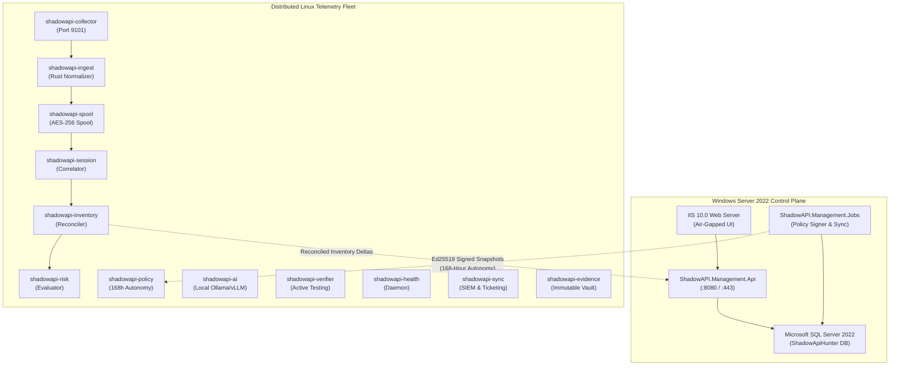

# Shadow API Hunter Enterprise ΓÇö Administrator Guide

**Version:** 1.0.0 Enterprise  
**Target Roles:** Enterprise Infrastructure Leads, Windows Administrators, Linux Fleet Engineers  
**Applies To:** Windows Server 2019/2022, Microsoft SQL Server 2019/2022, RHEL 8/9, AlmaLinux 9, Ubuntu 20.04/22.04 LTS  

---

## 1. System Overview & Architectural Topology

Shadow API Hunter Enterprise is structured into two decoupled tiers adhering to strict fault isolation (**ADR-0005**):



---

## 2. Port Allocation & Firewall Matrix

Ensure the following firewall rules are provisioned between security zones:

| Service / Component | Port | Protocol | Source | Destination | Purpose |
| :--- | :--- | :--- | :--- | :--- | :--- |
| **IIS Management UI** | 443 | HTTPS | User Browsers / Admin Bastion | Windows Host | Air-gapped UI console |
| **Management API** | 8080 | HTTP/S | IIS Reverse Proxy / Fleet | Windows Host | REST control plane API |
| **SQL Server** | 1433 | TCP | Windows Management Services | SQL Cluster | Relational database storage |
| **Collector Ingest** | 9101 | HTTP | Gateways, Proxies, Taps | Linux Sensor Nodes | Telemetry observation ingest |
| **Policy Cache** | 9102 | HTTP | Windows Sync Daemon | Linux Sensor Nodes | Signed policy snapshot delivery |
| **Spool Buffer API** | 9103 | HTTP | Local Subsystems | Linux Sensor Nodes | Spool sync & torn-write recovery |
| **Session Correlator** | 9104 | HTTP | Local Subsystems | Linux Sensor Nodes | Ephemeral identity progression |
| **Inventory Reconciler** | 9105 | HTTP | Local Subsystems / Windows | Linux Sensor Nodes | Spec matching & delta generation |
| **Risk Engine** | 9106 | HTTP | Local Subsystems / Windows | Linux Sensor Nodes | Deterministic scoring & evidence |
| **SIEM & Sync Daemon** | 9107 | HTTP | Windows API / Local | Linux Sensor Nodes | Splunk/Sentinel & Jira forwarding |
| **AI Router** | 9108 | HTTP | Local Risk Subsystems | Linux Sensor Nodes | Isolated local AI enrichment |
| **Fleet Health Daemon**| 9109 | HTTP | Windows Management Sync | Linux Sensor Nodes | Composite node health metrics |
| **Active Verifier** | 9110 | HTTP | Windows Management API | Linux Sensor Nodes | Scoped active hypothesis worker |
| **Evidence Vault** | 9111 | HTTP | Local Risk Subsystems | Linux Sensor Nodes | S3/Azure immutable evidence vault |

---

## 3. User Management & Role-Based Access Control (RBAC)

Shadow API Hunter provides 5 canonical enterprise roles with 15 granular permission scopes defined in Microsoft SQL Server table `auth.Roles`:

| Role | Scope | Permissions Granted | Typical Persona |
| :--- | :--- | :--- | :--- |
| **SystemAdmin** | Fleet-wide | Full administrative access, user management, key management, system config, kill switch reset | Platform Administrator, Infrastructure Lead |
| **SecurityAnalyst** | Multi-tenant | View inventory, view sanitized evidence, assign owners, trigger active verification within scopes | AppSec Analyst, SOC Tier 2/3 Responder |
| **ComplianceAuditor** | Read-only | View inventory, inspect compliance scores, download cryptographic audit packages and attestations | QSA, Internal Audit, Privacy Officer |
| **ApiOwner** | Assigned Scope | View owned API inventory, approve shadow APIs to managed, review spec drift alerts | Engineering Lead, API Product Owner |
| **ReadOnly** | Scoped Read | View non-sensitive inventory metadata; zero evidence payload access | Junior Analyst, DevOps Read-Only |

### Provisioning Users via Windows Integrated Authentication (WIA)
When deployed behind IIS with Windows Authentication enabled, domain users are automatically authenticated via Kerberos/SPNEGO (`X-IIS-Logon-User`). 

To map Active Directory users to roles:
```sql
USE [ShadowApiHunter];
GO

-- Assign CORP\appsec_team to SecurityAnalyst role
DECLARE @UserId UNIQUEIDENTIFIER = NEWID();
INSERT INTO [auth].[Users] (UserId, Username, Email, DisplayName, IsActive, CreatedAt)
VALUES (@UserId, 'CORP\appsec_team', 'appsec@corp.internal', 'AppSec Engineering', 1, SYSUTCDATETIME());

INSERT INTO [auth].[UserRoles] (UserId, RoleId, AssignedAt)
VALUES (@UserId, 'ROLE-SEC-ANALYST', SYSUTCDATETIME());
GO
```

---

## 4. Service Lifecycle Management

### Windows Control Plane Services
```powershell
# Query status of all Windows components
Get-Service -Name "ShadowAPI.*"

# Restart all control plane services
Restart-Service -Name "ShadowAPI.Management.Api"
Restart-Service -Name "ShadowAPI.Management.Jobs"
Restart-Service -Name "ShadowAPI.Management.Sync"
```

### Linux Sensor Fleet Daemons
All Linux components are registered as native systemd units under `/etc/systemd/system/`:
```bash
# Check status of all 12 Shadow API Hunter services
systemctl status shadowapi-*

# Gracefully reload configuration across all units
sudo systemctl reload-or-restart shadowapi-collector shadowapi-ingest shadowapi-spool shadowapi-session shadowapi-inventory shadowapi-risk shadowapi-policy shadowapi-ai shadowapi-verifier shadowapi-health shadowapi-sync shadowapi-evidence
```

---

## 5. Maintenance & Log Rotation

- **Linux Spool**: Encrypted disk spool partitions rotate automatically based on size (64 MB segment bounds) and age. Configure retention in `/etc/shadowapi/spool.conf`.
- **System Logs**: Managed via standard `systemd-journald`. Configure journal quotas in `/etc/systemd/journald.conf`:
  ```ini
  SystemMaxUse=5G
  ```
- **Database Index Optimization**: Execute weekly re-indexing on SQL Server:
  ```sql
  ALTER INDEX ALL ON [inventory].[ApiAssets] REORGANIZE;
  ALTER INDEX ALL ON [risk].[Findings] REORGANIZE;
  ```
